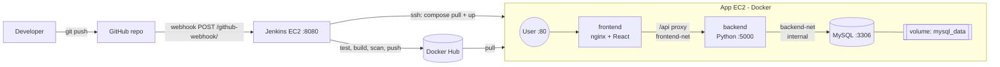

# Task Manager — End-to-End DevOps Project

A 3-tier app (**React + plain-Python REST API + MySQL**), containerised with **multi-stage Dockerfiles**, wired with **Docker networks and volumes**, and shipped by a **Jenkins pipeline on AWS EC2** that a **GitHub webhook** triggers on every push.



## Project layout

```
devops-taskmanager/
├── backend/                  Plain Python API (stdlib http.server + PyMySQL)
│   ├── app/server.py         HTTP server, routing, endpoints
│   ├── app/repository.py     MySQL data access (parameterised SQL)
│   ├── app/validation.py     Input validation
│   ├── app/config.py         Settings from environment variables
│   ├── tests/test_api.py     Tests (in-memory repo, no DB needed)
│   └── Dockerfile            builder -> test -> runtime
├── frontend/                 React (Vite) SPA
│   ├── src/                  App.jsx, api.js, styles
│   ├── nginx.conf            Static hosting + /api reverse proxy
│   └── Dockerfile            node build -> nginx-unprivileged runtime
├── db/init.sql               Schema, runs on first DB start
├── docker-compose.yml        Prod definition (images, networks, volume)
├── docker-compose.override.yml  Local-only build settings
├── Jenkinsfile               CI/CD pipeline
├── scripts/                  EC2 setup, Docker install, backup/restore
└── .env.example              Template for secrets (never commit .env)
```

### API

| Method | Path | Description |
|---|---|---|
| GET | `/api/health` | Liveness + DB connectivity (503 if DB down) |
| GET | `/api/stats` | Task counts by status |
| GET | `/api/tasks?status=todo` | List tasks (optional filter) |
| POST | `/api/tasks` | Create `{title, description?, priority?, status?}` |
| GET | `/api/tasks/{id}` | Get one |
| PUT/PATCH | `/api/tasks/{id}` | Partial update |
| DELETE | `/api/tasks/{id}` | Delete |

---

## Phase 1 — Environment & Application Setup

### 1.1 Install local tools

| Tool | Version | Check |
|---|---|---|
| Git | any recent | `git --version` |
| Python | 3.12 | `python --version` |
| Node.js | 20 LTS | `node --version` |
| Docker Desktop | latest (includes Compose v2) | `docker compose version` |

### 1.2 Run the backend locally

Start a throwaway MySQL with the schema loaded (PowerShell, from the project root):

```powershell
docker run -d --name taskmgr-mysql -p 3306:3306 `
  -e MYSQL_DATABASE=taskmgr -e MYSQL_USER=taskmgr -e MYSQL_PASSWORD=devpass `
  -e MYSQL_ROOT_PASSWORD=rootpass `
  -v "${PWD}/db/init.sql:/docker-entrypoint-initdb.d/01-init.sql:ro" mysql:8.0
```

Then run the API:

```powershell
cd backend
python -m venv .venv
.\.venv\Scripts\Activate.ps1          # Linux/macOS: source .venv/bin/activate
pip install -r requirements-dev.txt

flake8 app tests                       # lint
python -m pytest -v                    # 12 tests, no DB needed

$env:DB_HOST="127.0.0.1"; $env:DB_PASSWORD="devpass"
python -m app.server                   # http://localhost:5000/api/health
```

### 1.3 Run the frontend locally

```powershell
cd frontend
npm install                            # generates package-lock.json - commit it
npm run dev                            # http://localhost:3000 (proxies /api -> :5000)
```

### 1.4 Push to GitHub

```powershell
git init
git add .
git commit -m "Initial commit: 3-tier task manager"
git branch -M main
git remote add origin https://github.com/<you>/devops-taskmanager.git
git push -u origin main
```

> `.gitattributes` forces LF line endings on `*.sh`/`Jenkinsfile`. Without it, Windows CRLF line endings break the scripts on Linux with `$'\r': command not found`.

### Why these choices (Phase 1)

- **The backend uses plain Python, not a framework.** It uses stdlib `ThreadingHTTPServer` and needs only one dependency (`PyMySQL`). That keeps the image tiny and shows you understand HTTP itself: routing, status codes, content length, body limits and graceful `SIGTERM`.
- **Data access sits behind a repository class.** Tests swap in an in-memory repository, so CI runs unit tests in seconds with **no database**. That is the classic test pyramid: fast unit tests first, then smoke/integration tests after deploy.
- **All config comes from environment variables (12-factor).** The same image runs locally, on EC2 and later on Kubernetes (ConfigMap/Secret). Nothing is baked into the image.
- **Security basics:** every SQL value is parameterised (no SQL injection), update columns come from a whitelist, request bodies are capped at 64 KB, errors never leak stack traces, and React escapes all output (no XSS).
- **The frontend calls relative `/api` URLs.** The browser only ever talks to one origin, so there is **no CORS** setup. nginx (prod) and Vite (dev) do the proxying.

---

## Phase 2 — Dockerization Strategy

Files: [backend/Dockerfile](backend/Dockerfile), [frontend/Dockerfile](frontend/Dockerfile), [docker-compose.yml](docker-compose.yml), [docker-compose.override.yml](docker-compose.override.yml), [frontend/nginx.conf](frontend/nginx.conf).

### 2.1 Multi-stage builds

| Image | Stages | What ships in the final image |
|---|---|---|
| backend | `builder` (venv + deps) → `test` (adds pytest/flake8 + tests) → `runtime` | slim Python + venv + `app/` only, **non-root user**, HEALTHCHECK |
| frontend | `build` (Node 20, `npm run build`) → `runtime` | **nginx-unprivileged** + static `dist/` only. No Node, no `node_modules` |

The frontend drops from roughly 1 GB (node + node_modules) to roughly 50 MB.

### 2.2 Networking

| Network | Members | Purpose |
|---|---|---|
| `frontend-net` (bridge) | frontend, backend | nginx → backend:5000 |
| `backend-net` (bridge, **internal: true**) | backend, db | backend → db:3306; no internet route |

- Only the **frontend publishes a port** (`80:8080`). The backend and MySQL are unreachable from outside the host.
- The frontend is **not** on `backend-net`, so even a compromised nginx container cannot reach MySQL.
- Containers find each other by **service name** (`backend`, `db`) through Docker's embedded DNS.

### 2.3 Volumes

- `mysql_data` is a **named volume** mounted at `/var/lib/mysql`. Data survives `docker compose down`, container recreation and image upgrades. Only `down -v` deletes it.
- `./db/init.sql` is a **read-only bind mount** into `docker-entrypoint-initdb.d`. It runs **only when the volume is empty** (first boot).

### 2.4 Startup ordering and health

`db (healthy) → backend (healthy) → frontend`, using `depends_on: condition: service_healthy`.
The MySQL healthcheck uses `-h 127.0.0.1` to force TCP. During init, MySQL runs a temporary server that answers on the Unix socket only, so a socket-based ping would report "healthy" too early. This is a good interview detail.

### 2.5 Try it locally

```powershell
copy .env.example .env                 # edit passwords
docker compose up -d --build           # override file adds build: sections automatically
docker compose ps                      # all three should become "healthy"
start http://localhost
```

Verify each concept:

```powershell
docker images | Select-String taskmgr                     # compare image sizes
docker network ls ; docker network inspect taskmgr_backend-net
docker compose exec frontend wget -qO- http://db:3306     # FAILS: "bad address 'db'" = isolation works
docker compose exec frontend wget -qO- http://backend:5000/api/health   # works

# Persistence test: add tasks in the UI, then
docker compose down ; docker compose up -d                # tasks are still there
docker volume inspect taskmgr_mysql_data
```

### Why these choices (Phase 2)

- **Multi-stage builds** keep compilers, dev dependencies, tests and Node out of production. That means smaller images, faster pulls, a smaller attack surface and fewer CVEs. The **`test` target** lets CI run tests in exactly the same environment as production, using the same base image and dependency versions.
- **Non-root containers** (`USER app`, `nginx-unprivileged` on 8080) limit the damage if a container is compromised. Kubernetes `runAsNonRoot` policies will also require this later.
- **Two networks with `internal: true`** apply least privilege at the network layer: a 3-tier DMZ in miniature.
- **The compose base + override split:** `docker-compose.yml` is production (images only) and is the only file copied to the server. The override adds `build:` for local development. One source of truth, and no source code on the server.
- **`${VAR:?message}`** makes compose fail fast if a secret is missing, instead of starting MySQL with an empty password.

---

## Phase 3 — AWS & Jenkins Implementation

### 3.1 Architecture on AWS

Use **two EC2 instances** in the same VPC/subnet:

| Instance | Suggested type | Disk | Role |
|---|---|---|---|
| `jenkins-server` | t3.medium (2 vCPU / 4 GB) | 30 GB gp3 | Jenkins + Docker (builds images) |
| `app-server` | t3.small (2 GB) + 2 GB swap | 20 GB gp3 | Runs the 3 containers |

AMI: **Ubuntu Server 24.04 LTS**. Create one key pair (e.g. `devops-key.pem`) for your own SSH access.

### 3.2 Security groups

**`sg-jenkins`**

| Port | Source | Why |
|---|---|---|
| 22 | My IP/32 | Admin SSH |
| 8080 | My IP/32 | Jenkins UI |
| 8080 | GitHub hook CIDRs (see below) | Webhook delivery |

**`sg-app`**

| Port | Source | Why |
|---|---|---|
| 80 | 0.0.0.0/0 | Public web traffic |
| 22 | My IP/32 | Admin SSH |
| 22 | **sg-jenkins** (security group reference) | Jenkins deploys over SSH |

> **Gotcha:** if 8080 is open only to *your* IP, GitHub can't deliver webhooks. Get GitHub's webhook ranges with `curl -s https://api.github.com/meta | jq .hooks` and add them to `sg-jenkins`. In production, you'd put Jenkins behind an ALB/reverse proxy with HTTPS.
>
> **Gotcha:** security group references only match **private IPs**, so Jenkins must SSH to the app server's **private IP** (this is what the Jenkinsfile expects).

### 3.3 Elastic IP

Allocate an **Elastic IP** and associate it with `jenkins-server`. Without one, the public IP changes on every stop/start and the GitHub webhook URL breaks.

### 3.4 Install Jenkins (on jenkins-server)

```bash
ssh -i devops-key.pem ubuntu@<JENKINS_EIP>
git clone https://github.com/<you>/devops-taskmanager.git
cd devops-taskmanager/scripts
bash setup-jenkins-server.sh          # installs Java 21, Jenkins LTS, Docker; prints admin password
```

Open `http://<JENKINS_EIP>:8080`:

1. Paste the initial admin password, then choose **Install suggested plugins**, then create an admin user.
2. **Manage Jenkins → Plugins → Available**, install: **GitHub**, **SSH Agent**, **Pipeline: Stage View** (Git, Pipeline, Credentials Binding, JUnit and Timestamper come with the suggested plugins).
3. **Manage Jenkins → System → Jenkins URL** = `http://<JENKINS_EIP>:8080/`.

### 3.5 Prepare the app server

```bash
ssh -i devops-key.pem ubuntu@<APP_PUBLIC_IP>
git clone https://github.com/<you>/devops-taskmanager.git
bash devops-taskmanager/scripts/setup-app-server.sh
nano /opt/taskmgr/.env                # set DOCKERHUB_USER (DB passwords were randomly generated)
exit                                  # re-login so the docker group applies
```

### 3.6 SSH key for Jenkins → app server

On **jenkins-server**:

```bash
sudo -u jenkins ssh-keygen -t ed25519 -N "" -f /var/lib/jenkins/.ssh/id_ed25519 -C jenkins-deploy
sudo cat /var/lib/jenkins/.ssh/id_ed25519.pub      # copy this
```

On **app-server**, append it to `~/.ssh/authorized_keys`. Then test from Jenkins:

```bash
sudo -u jenkins ssh -o StrictHostKeyChecking=accept-new ubuntu@<APP_PRIVATE_IP> 'docker ps'
```

### 3.7 Jenkins credentials

**Manage Jenkins → Credentials → System → Global → Add Credentials**

| ID | Kind | Value |
|---|---|---|
| `dockerhub-creds` | Username with password | Docker Hub username + **access token** (Docker Hub → Account Settings → Personal access tokens), not your password |
| `app-server-ssh` | SSH Username with private key | Username `ubuntu`, paste `/var/lib/jenkins/.ssh/id_ed25519` |
| `github-token` *(private repos only)* | Username with password | GitHub username + fine-grained PAT (Contents: read) |

Create two **public** Docker Hub repositories: `taskmgr-backend` and `taskmgr-frontend`. If you make them private, run `docker login` once on the app server.

### 3.8 Create the pipeline job

1. **New Item** → name `taskmgr` → **Pipeline**.
2. **Build Triggers**: check **GitHub hook trigger for GITScm polling**.
3. **Pipeline**: *Pipeline script from SCM* → Git → repo URL → credentials (if private) → branch `*/main` → Script Path `Jenkinsfile`.
4. Save.

### 3.9 Configure the GitHub webhook

GitHub repo → **Settings → Webhooks → Add webhook**:

| Field | Value |
|---|---|
| Payload URL | `http://<JENKINS_EIP>:8080/github-webhook/` (**trailing slash required**) |
| Content type | `application/json` |
| Secret | *(optional, recommended)* a random string; also add it in Jenkins → System → GitHub → Advanced → Shared secrets |
| Events | Just the push event |

After saving, open **Recent Deliveries**. A green tick with HTTP 200 means Jenkins received it.

### Why these choices (Phase 3)

- **Separate CI and runtime hosts.** Builds are CPU- and disk-heavy and must not starve the production app. A compromised build (malicious dependency) also cannot directly touch production data. This is the standard "build server ≠ app server" separation.
- **Pipeline-as-code from SCM.** The Jenkinsfile is versioned, reviewed and rolled back like any other code.
- **Push-based webhook instead of SCM polling.** Builds start within seconds, and Jenkins does not hammer GitHub every minute.
- **The registry is the hand-off point.** The app server only *pulls* immutable, tagged images, so it never needs source code or build tools.
- **Least-privilege credentials.** These are scoped tokens rather than passwords, and they are held in the Jenkins credential store, masked in logs and never put in Git.
- **Trade-off to mention in interviews:** adding `jenkins` to the `docker` group is effectively root on that host. Hardened setups use ephemeral build agents (EC2/K8s agents) or rootless/Kaniko builds.

---

## Phase 4 — CI/CD Pipeline Definition

File: [Jenkinsfile](Jenkinsfile). Edit the two TODO values first: `DOCKERHUB_USER` and `APP_SERVER` (`ubuntu@<APP_PRIVATE_IP>`).

| # | Stage | What happens | Fails the build when |
|---|---|---|---|
| 1 | Prepare | Tag = `<build#>-<git sha>` (e.g. `14-a1b2c3d`) | Docker missing |
| 2 | Lint & Unit Tests | `docker build --target test`, run flake8 + pytest, publish JUnit report | Lint/test failure |
| 3 | Build Images | Backend + frontend built **in parallel**; tagged `<tag>` and `latest` | Build error |
| 4 | Image Scan | Trivy scans for HIGH/CRITICAL CVEs (report-only; flip `--exit-code 1` to enforce) | (optional) vulns |
| 5 | Push Images | `docker login --password-stdin`, push both tags | Auth/push error |
| 6 | Deploy | scp compose + init.sql, then `compose pull` + `up -d` over SSH with `IMAGE_TAG` | SSH/compose error |
| 7 | Smoke Test | Polls `http://<app>/api/health` for up to 60 s | App unhealthy |
| — | post | `docker logout`, remove test image, prune | — |

### 4.1 First run

Click **Build Now** once manually. Jenkins registers the `githubPush()` trigger from the Jenkinsfile during the first run.

### 4.2 Prove the webhook end-to-end

```powershell
# change something visible, e.g. the <h1> in frontend/src/App.jsx
git commit -am "Change heading"
git push
```

Within seconds a new build starts. When it goes green, refresh `http://<APP_PUBLIC_IP>` to see the change.

Break a test on purpose (e.g. change an expected value in `tests/test_api.py`) and push. The pipeline should stop at stage 2 with a red JUnit report, and **nothing is deployed**. This is a powerful demo.

### 4.3 Rollback

Every build is an immutable tag, so rolling back means redeploying an old tag:

```bash
ssh ubuntu@<APP_PUBLIC_IP>
cd /opt/taskmgr
cat .deployed_tag                                  # current
IMAGE_TAG=12-9f8e7d6 docker compose up -d          # previous good tag
```

### Why these choices (Phase 4)

- **Fail fast, cheapest first.** Lint/unit tests (seconds) run before builds, scans and pushes (minutes).
- **Immutable `build#-sha` tags** give traceability (image → commit → build log) and one-command rollbacks. `latest` is only a convenience pointer and is never relied on for deploys.
- **Parallel builds** cut wall-clock time, and the backend runtime build reuses the `builder` layer cache from the test stage.
- **Shift-left security:** the Trivy scan happens before the image reaches a registry or server.
- **A smoke test after deploy** proves the *deployed system* works (nginx → backend → MySQL), not just the code. `/api/health` checks the DB connection on purpose.
- **`disableConcurrentBuilds` + timeout** stop two deploys racing each other or hung builds holding the executor.

---

## Phase 5 — Operations (bonus interview points)

### Backups

```bash
# On app-server
/opt/taskmgr/backup-mysql.sh                                  # manual
crontab -e
0 2 * * * /opt/taskmgr/backup-mysql.sh >> /opt/taskmgr/backups/backup.log 2>&1

# Off-host copy: attach an IAM role with s3:PutObject to the instance, install the AWS CLI, then
S3_BUCKET=my-taskmgr-backups /opt/taskmgr/backup-mysql.sh

# Restore
/opt/taskmgr/restore-mysql.sh /opt/taskmgr/backups/taskmgr-20261125-020000.sql.gz
```

Talking points:
- **Logical backups** (`mysqldump --single-transaction`) are consistent without locking, portable and restorable to any MySQL version. **Physical backups** (tarring the volume, EBS snapshots) are faster for large DBs but need the DB stopped or quiesced.
- Follow the **3-2-1 rule**: local copy, S3 (with lifecycle to Glacier), plus **EBS snapshots via AWS Data Lifecycle Manager**.
- **An untested backup is not a backup.** Periodically restore into a scratch container.

### Security checklist

- [ ] SG: 22/8080 restricted to your IP; app 22 only from `sg-jenkins`
- [ ] `.env` is `chmod 600`, never in Git; Docker Hub uses an access token
- [ ] Containers run as non-root; DB is on an internal network with no published port
- [ ] Trivy scan in pipeline; consider `--exit-code 1` once the baseline is clean
- [ ] Next steps: HTTPS (Let's Encrypt/ALB + ACM), AWS Secrets Manager/SSM Parameter Store, Jenkins behind a reverse proxy

### Monitoring quick wins

`docker compose ps` (health status), `docker compose logs -f backend`, `docker stats`. Next: CloudWatch agent, or Prometheus + Grafana.

---

## Troubleshooting

| Symptom | Cause / Fix |
|---|---|
| Webhook delivery shows timeout | 8080 not open to GitHub hook CIDRs, or the Jenkins IP changed (use an Elastic IP) |
| Webhook 200 but no build | Run the job manually once; check "GitHub hook trigger" is ticked; URL needs the trailing `/` |
| `permission denied ... docker.sock` in Jenkins | `sudo usermod -aG docker jenkins && sudo systemctl restart jenkins` |
| `$'\r': command not found` | CRLF line endings; `.gitattributes` fixes new checkouts, so re-clone |
| Deploy stage `Host key verification failed` | SSH once manually as the jenkins user (3.6) |
| backend stuck "starting" | `docker compose logs db backend`; wrong `DB_PASSWORD` or DB still initialising |
| Changed `init.sql` but no effect | It only runs on an empty volume; apply the change manually or `down -v` (**destroys data**) |
| App server out of memory | Use t3.small+ and confirm swap: `swapon --show` |

---

## Interview Questions You Can Now Answer

1. *Why multi-stage builds?* Smaller image, smaller attack surface, build tools are not shipped, and the test stage gives env parity.
2. *How do containers discover each other?* Through Docker's embedded DNS on user-defined bridge networks, by service name.
3. *What happens to data on `docker compose down`?* The named volume persists. Only `down -v` removes it.
4. *Bind mount vs named volume?* A bind mount maps a host path (config, init scripts). A named volume is managed by Docker and is portable (DB data).
5. *`depends_on` alone vs `condition: service_healthy`?* Alone it only orders *start*. With the condition, it waits for *readiness*.
6. *How do you roll back?* Redeploy the previous immutable image tag.
7. *Where do secrets live?* Jenkins Credentials (CI) and `.env` with 600 perms (runtime). Next step: Secrets Manager / K8s Secrets.
8. *Webhook vs polling?* Push-based means lower latency and no wasted API calls, but it needs inbound reachability.
9. *What does `internal: true` do?* No external connectivity or gateway on that network; it isolates the DB tier.
10. *Why handle SIGTERM in the Python server?* PID 1 in a container ignores SIGTERM by default, so `docker stop` would wait 10 s and then SIGKILL. Handling it enables graceful shutdown (essential for K8s rolling updates).

---

## Next: Kubernetes Readiness

This project is already structured for the move:

| Compose concept | Kubernetes equivalent |
|---|---|
| `backend`/`frontend` services | Deployment + Service (ClusterIP) |
| Published port 80 on frontend | Ingress (or LoadBalancer Service) |
| `db` + `mysql_data` volume | StatefulSet + PersistentVolumeClaim (or Amazon RDS) |
| `.env` non-secret values | ConfigMap |
| `DB_PASSWORD`, `DB_ROOT_PASSWORD` | Secret |
| HEALTHCHECK / `/api/health` | readinessProbe / livenessProbe |
| `internal` network | NetworkPolicy |
| `init.sql` bind mount | ConfigMap mounted into `/docker-entrypoint-initdb.d` |
| Jenkins `compose up` over SSH | `kubectl set image` / Helm upgrade / Argo CD (GitOps) |

Because the nginx config proxies to `backend:5000`, naming the K8s Service `backend` means **no app or config changes** are needed.
